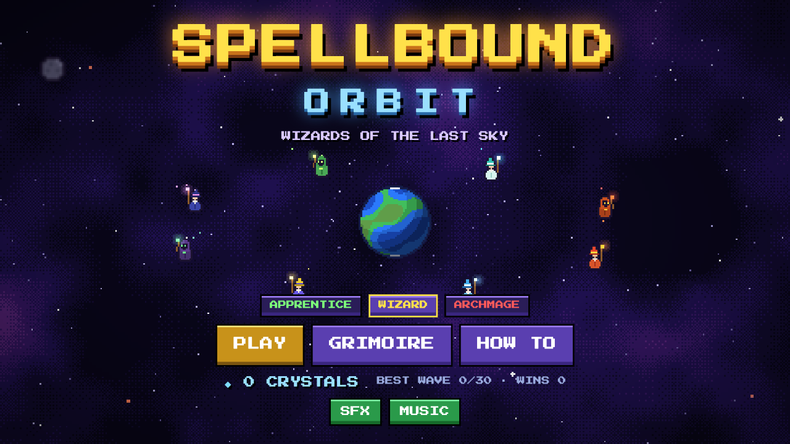
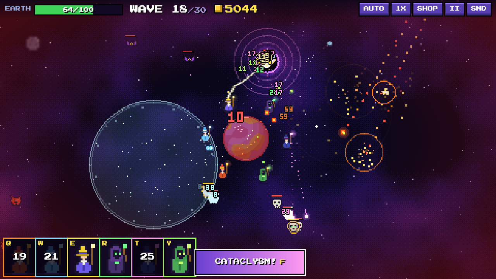

# ✦ Spellbound Orbit

**Wizards of the last sky.** A pixel-art, roguelite tower defense where a circle of wizards orbits the Earth and unleashes over-the-top spells against the void. Inspired by *Orbital Defense Program*, rebuilt with magic, a 30-wave campaign, relics, bosses and meta-progression.

▶ **Play:** https://goodstuff2.github.io/spellbound-orbit/




## Features
- **8 wizards**, each with a unique auto-attack and a screen-filling spell:
  Pyromancer (*Meteor Storm*), Frost Witch (*Blizzard*), Stormcaller (*Thunder Tempest*), Necromancer (*Soul Harvest*), Star Sage (*Black Hole*), Gaia Druid (*Gaia's Embrace*), Chronomancer (*Time Stop*), Dragon Caller (*Summon Dragon*)
- **Familiars:** every wizard has summons that fight beside them (Fire Imp, Frost Sprite, Spark Wisp, Bone Knight, Star Orb, Thorn Sprout, Clockwork, Drake Whelp). Foes drop **runes** (hover to grab) that raise their power, count and skill ranks; upgrade them in the shop or via relics
- **Arcane Cataclysm** ultimate, charged by kills: slow-motion charge-up, screen-wide blast, resets every cooldown
- **30 waves + endless mode**, a boss every 5th wave (Demon Lord, Eye of the Void, Bone Wyrm… and the Void Emperor)
- **Roguelite loop:** pick 1 of 3 relics after each wave (20 relics, 3 rarities), upgrade up to 6 wizards to level 12, recruit more, repair Earth
- **Meta progression:** earn crystals each run to unlock wizards and permanent boons in the Grimoire
- 3 difficulties, elite enemies, healers, splitters, bombers, shooters, armored golems
- Smooth 60 fps fixed-timestep canvas renderer at 480×270 with integer-style pixel scaling, procedurally generated sprites, rotating pixel Earth, dithered nebula, additive glow, screen shake
- Fully synthesized sound and music (Web Audio, no asset files)
- 1x / 2x / 3x speed, auto-cast, pause, saves to localStorage

## Controls
| Key | Action |
|---|---|
| `Q W E R T Y` / `1-6` | Cast wizard spell (aimed spells land on the mouse cursor) |
| Click spell icon, then click field | Aim and cast (touch friendly) |
| `F` | Arcane Cataclysm |
| `Space` | Start next wave |
| `B` | Shop (upgrade / recruit / supplies) |
| `A` | Auto-cast · `G` speed · `P`/`Esc` pause · `M` mute |

## Run locally
No build step, no dependencies. Open `index.html`, or serve the folder:
```
python3 -m http.server 8000
```

## Credits
Code and art generated in-code. Font: *Press Start 2P* by CodeMan38 (SIL OFL 1.1).
